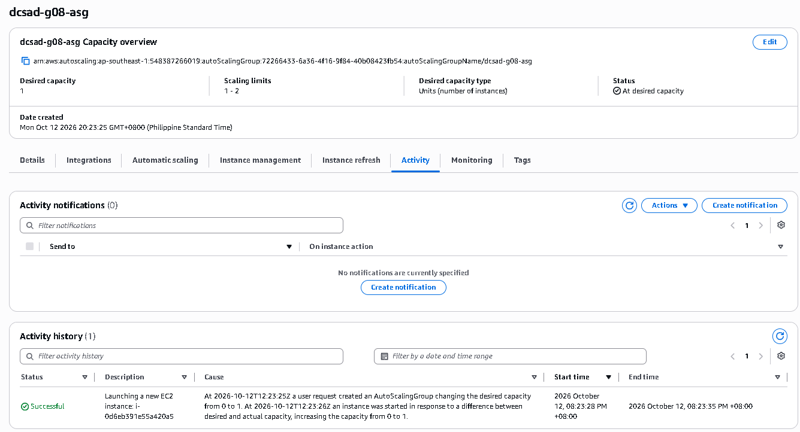
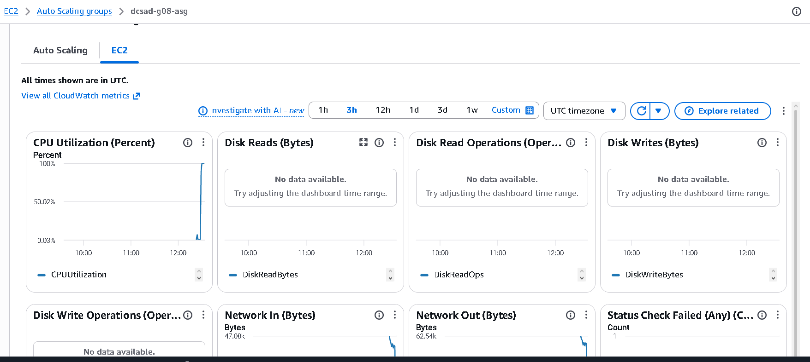

# Lab 2 Submission

## Instance Tracking
**First Instance**
- Instance ID: i-0d6eb391e55a420a5
- Availability Zone: ap-southeast-1a

**Second Instance**
- Instance ID: i-0d5c1db7623c3e765
- Availability Zone: ap-southeast-1b

## Proof (Screenshots)
1. **Activity History:** Add a screenshot showing the Auto Scaling group's Activity history when the second instance launched.
   
   

2. **CloudWatch Alarm:** Add a screenshot of the target tracking alarm in the "In alarm" state.

   

## Questions
1. Why did the group stop at 2 instances?
   The Auto Scaling group reached its configured Maximum Capacity (Set to 2), which prevents the group from scaling out further regardless of load.
2. Why did terminating an instance by hand not remove the cost?
   The Auto Scaling group automatically detected the missing instance as unhealthy or missing, and immediately launched a new replacement instance to maintain the Desired Capacity.
3. Why is the target value set to your assigned value (e.g., 30-85 percent) instead of 99 percent?
   Setting it to 99% leaves no head-room for sudden traffic spikes while scaling out. A lower target (e.g., 30–85%) gives the system buffer time to launch new instances before the current ones become overloaded or crash.
4. What did the automatic cutoff protect us from?
   It protected against runaway AWS infrastructure costs and uncontrolled cloud resource consumption caused by continuous scaling during high traffic or DDoS/loop conditions.
5. What changes when a load balancer sits in front of the group?
   Traffic is automatically distributed across all healthy instances, and scaling metrics can switch from individual EC2 CPU usage to load balancer metrics (like Request Count per Target or Target Response Time).
