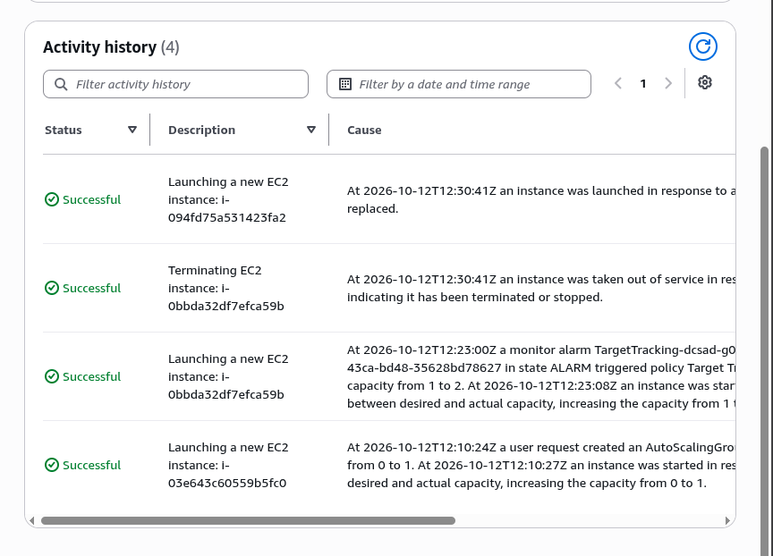
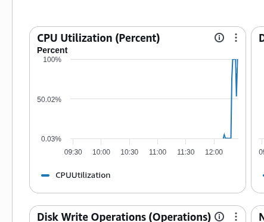

# Lab 2 Submission

## Instance Tracking
**First Instance**
- Instance ID: i-03e643c60559b5fc0
- Availability Zone: ap-southeast-1a

**Second Instance**
- Instance ID: i-0bbda32df7efca59b
- Availability Zone: ap-southeast-1b

## Proof (Screenshots)
1. **Activity History:** Add a screenshot showing the Auto Scaling group's Activity history when the second instance launched.
   
   

2. **CloudWatch Alarm:** Add a screenshot of the target tracking alarm in the "In alarm" state.

   

## Questions
1. Why did the group stop at 2 instances?
   Because we only set the maximum capacity limit of the auto scaling group to 2 during the setup.
2. Why did terminating an instance by hand not remove the cost?
   Because the auto scaling group was designed to maintain the set capacity. When it detected the 2nd instance was gone, it automatically launched a second one to match the capacity.
3. Why is the target value set to your assigned value (e.g., 30-85 percent) instead of 99 percent?
   The CPU could max out and the server could crash or drop requests before another instance had enough time to boot and share the load.
4. What did the automatic cutoff protect us from?
   It protected the AWS account from getting extra charges or fees if we forgot to manually stop the stress test or clean the running resources after the activity.
5. What changes when a load balancer sits in front of the group?
   It provides a single entry point, users wouldn't have to manually type the public ip address of each instance to reach the app, and traffic would be distributed across the server equally.
