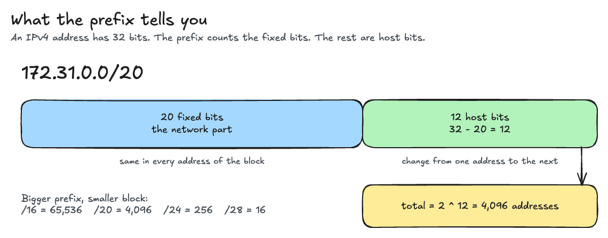
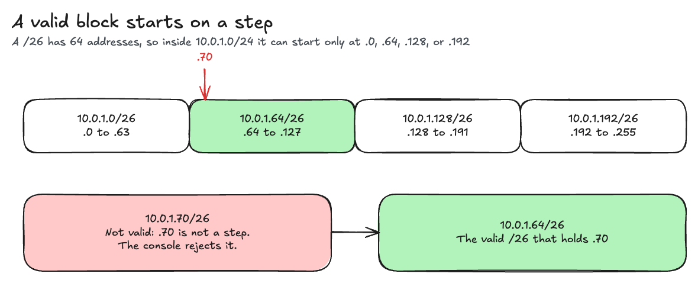
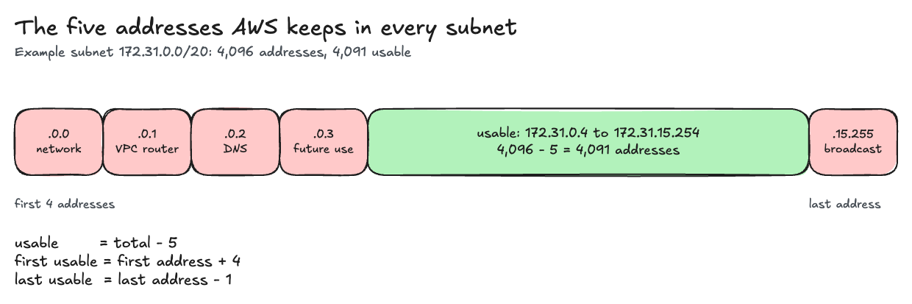
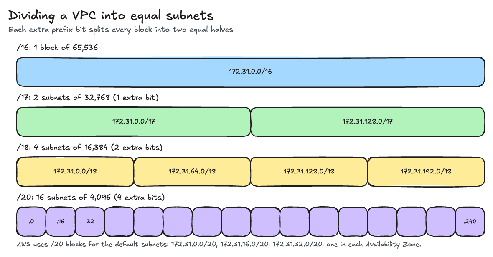
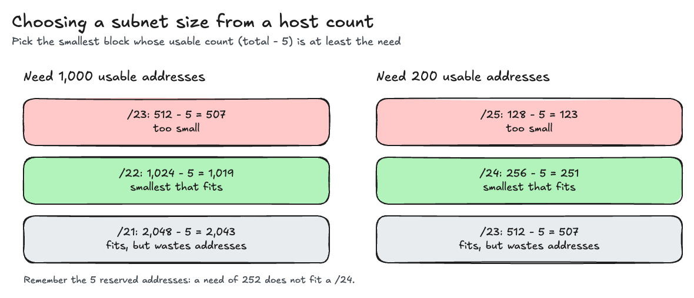
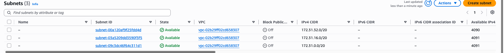
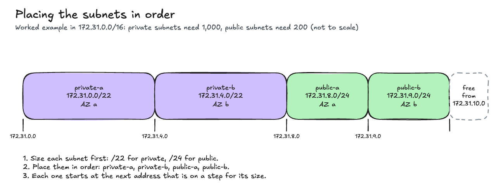
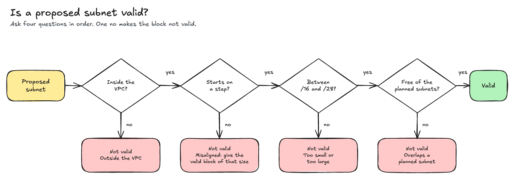

# Lab 3: VPC Subnet Planning Case Study

This lab is about the step that comes before you click **Create VPC**: choosing the addresses. AWS does not let you resize a VPC CIDR block later, so a group that picks the wrong size has to rebuild the VPC. In this lab your group plans the subnets of one client's VPC. You do the math that the AWS console does for you.

You do not create anything in AWS. Every value you need is in this folder or in [`lab.md`](lab.md).

## The six rules you use

### 1. Total addresses



A CIDR block such as `10.0.0.0/24` has two parts. The address is `10.0.0.0`. The prefix is `/24`. The prefix counts the fixed bits from the left. An IPv4 address has 32 bits, so the rest are host bits.

```
host bits = 32 - prefix
total     = 2 ^ host bits
```

| Prefix | Host bits | Total addresses |
| --- | --- | --- |
| `/16` | 16 | 65,536 |
| `/20` | 12 | 4,096 |
| `/22` | 10 | 1,024 |
| `/24` | 8 | 256 |
| `/26` | 6 | 64 |
| `/28` | 4 | 16 |

### 2. First and last address

The first address is the address in the CIDR block, when the block is valid. To find the last address, add `total - 1` to the first address. Carry into the octet on the left when an octet passes 255.

| CIDR | Total | Add | First | Last |
| --- | --- | --- | --- | --- |
| `10.0.0.0/24` | 256 | 255 to the 4th octet | `10.0.0.0` | `10.0.0.255` |
| `172.31.16.0/20` | 4,096 | 15 to the 3rd octet, 255 to the 4th | `172.31.16.0` | `172.31.31.255` |
| `10.0.1.64/26` | 64 | 63 to the 4th octet | `10.0.1.64` | `10.0.1.127` |

A shortcut for prefixes `/17` to `/24`: the block covers `2 ^ (24 - prefix)` values of the 3rd octet. A `/20` covers 16 values, so `172.31.16.0/20` runs from `.16.0` to `.31.255`. For prefixes `/25` to `/32`, the block covers `2 ^ (32 - prefix)` values of the 4th octet.

### 3. A valid block starts on a step



The first address must be a multiple of the block size in the octet that changes. A `/26` has 64 addresses, so a `/26` can start at `.0`, `.64`, `.128`, or `.192` of the 4th octet, and nowhere else. `10.0.1.70/26` is not a valid block. The AWS console rejects it. The `/26` that holds `.70` is `10.0.1.64/26`.

### 4. The five addresses that AWS keeps



In every subnet, AWS reserves the first four addresses and the last address. Your servers cannot use them. For the subnet `10.0.0.0/24`:

| Address | What AWS uses it for |
| --- | --- |
| `10.0.0.0` | The network address |
| `10.0.0.1` | The VPC router |
| `10.0.0.2` | The DNS server (the base of the VPC range plus two) |
| `10.0.0.3` | Kept by AWS for future use |
| `10.0.0.255` | The network broadcast address. A VPC does not support broadcast, so AWS keeps it |

So:

```
usable       = total - 5
first usable = first address + 4
last usable  = last address - 1
```

A `/24` subnet has 256 addresses and 251 usable addresses, from `10.0.0.4` to `10.0.0.254`. The console shows the usable count in the **Available IPv4 addresses** column of the Subnets page. A subnet with no servers in it shows `total - 5`.

AWS allows a VPC or subnet block from `/16` (65,536 addresses) to `/28` (16 addresses). A `/29` or `/30` is a valid CIDR, but AWS rejects it for a subnet.

Source: [Subnet CIDR blocks](https://docs.aws.amazon.com/vpc/latest/userguide/subnet-sizing.html) and [VPC CIDR blocks](https://docs.aws.amazon.com/vpc/latest/userguide/vpc-cidr-blocks.html), Amazon VPC User Guide.

### 5. Dividing a block



Each extra bit in the prefix splits a block into two equal halves. To divide a block into `N` equal subnets, where `N` is 2, 4, 8, or 16:

```
extra bits = 1 for 2 subnets, 2 for 4, 3 for 8, 4 for 16
new prefix = old prefix + extra bits
```

The subnets sit next to each other. Subnet 1 starts at the first address of the block. Each next subnet starts one address after the last address of the one before it.

To fit subnets of a given size into a block:

```
number of subnets = 2 ^ (new prefix - old prefix)
first address of subnet number k = first address of the block + (k - 1) x subnet size
```

### 6. Choosing a size from a host count



When a client says a subnet needs a number of usable addresses, pick the smallest block whose usable count is at least that number. Remember the five addresses that AWS keeps.

| Prefix | Total | Usable |
| --- | --- | --- |
| `/28` | 16 | 11 |
| `/27` | 32 | 27 |
| `/26` | 64 | 59 |
| `/25` | 128 | 123 |
| `/24` | 256 | 251 |
| `/23` | 512 | 507 |
| `/22` | 1,024 | 1,019 |
| `/21` | 2,048 | 2,043 |
| `/20` | 4,096 | 4,091 |
| `/19` | 8,192 | 8,187 |
| `/18` | 16,384 | 16,379 |

A subnet that needs 251 usable addresses fits in a `/24`. A subnet that needs 252 needs a `/23`.

## Worked example: the default VPC

Every AWS account has a default VPC in each Region. In the class account, in Asia Pacific (Singapore), it is `172.31.0.0/16`. This example plans it the way you plan your client's VPC.

### Task 1 example: divide into 16 equal subnets

16 subnets need 4 extra bits, so the new prefix is `/16 + 4 = /20`. Each `/20` has 4,096 addresses and 4,091 usable addresses.

| # | CIDR | First | Last | Usable | First usable | Last usable |
| --- | --- | --- | --- | --- | --- | --- |
| 1 | `172.31.0.0/20` | 172.31.0.0 | 172.31.15.255 | 4,091 | 172.31.0.4 | 172.31.15.254 |
| 2 | `172.31.16.0/20` | 172.31.16.0 | 172.31.31.255 | 4,091 | 172.31.16.4 | 172.31.31.254 |
| 3 | `172.31.32.0/20` | 172.31.32.0 | 172.31.47.255 | 4,091 | 172.31.32.4 | 172.31.47.254 |
| ... | | | | | | |
| 16 | `172.31.240.0/20` | 172.31.240.0 | 172.31.255.255 | 4,091 | 172.31.240.4 | 172.31.255.254 |

Reserved addresses of subnet 1: `172.31.0.0`, `172.31.0.1`, `172.31.0.2`, `172.31.0.3`, and `172.31.15.255`.

AWS made the default subnets this way. The Subnets page of the class account shows the first three:



The **Available IPv4 addresses** column shows 4,091 for an empty `/20`. A subnet that shows 4,090 has one address in use, for example by an instance.

### Task 2 example: subnets of size `/24`

- 2a. `2 ^ (24 - 16) = 256` subnets.
- 2b. Each has 251 usable addresses.
- 2c. Subnet number 5 starts at `172.31.0.0 + 4 x 256`, which is `172.31.4.0`. So it is `172.31.4.0/24`, usable `172.31.4.4` to `172.31.4.254`.
- 2d. The last subnet is `172.31.255.0/24`.

### Task 3 example: private subnets need 1,000, public subnets need 200



A `/22` has 1,019 usable addresses, and a `/23` has only 507, so each private subnet is a `/22`. A `/24` has 251, and a `/25` has only 123, so each public subnet is a `/24`.

| Subnet | Prefix | CIDR | Availability Zone | Usable |
| --- | --- | --- | --- | --- |
| private-a | `/22` | `172.31.0.0/22` | ap-southeast-1a | 1,019 |
| private-b | `/22` | `172.31.4.0/22` | ap-southeast-1b | 1,019 |
| public-a | `/24` | `172.31.8.0/24` | ap-southeast-1a | 251 |
| public-b | `/24` | `172.31.9.0/24` | ap-southeast-1b | 251 |

`private-a` ends at `172.31.3.255`, so `private-b` starts at `172.31.4.0`. `private-b` ends at `172.31.7.255`. `172.31.8.0` is on a step for a `/24`, so `public-a` starts there.

### Task 4 example: proposals for the same VPC



| Proposal | Answer | Why |
| --- | --- | --- |
| `172.31.10.0/24` | Valid | Inside the VPC, on a step, and it overlaps none of the four subnets above. |
| `172.31.9.128/25` | Not valid | It overlaps `public-b`, `172.31.9.0/24`. |
| `172.31.12.70/26` | Not valid | It does not start on a step. The `/26` that holds `.70` is `172.31.12.64/26`. |
| `172.31.20.0/29` | Not valid | A `/29` is smaller than `/28`, the smallest subnet that AWS allows. |
| `172.32.0.0/24` | Not valid | It is outside the VPC, which ends at `172.31.255.255`. |

## Why this matters

A subnet that is too small runs out of addresses. An Auto Scaling group, a load balancer, and an RDS database each take addresses from the subnet. A VPC that is too large wastes nothing in money, but it can overlap with another network that you later connect to, such as an office network or a second VPC. Overlapping blocks cannot be peered.

## Submission

See [`lab.md`](lab.md) for your group's client, the four tasks, and how to submit.
