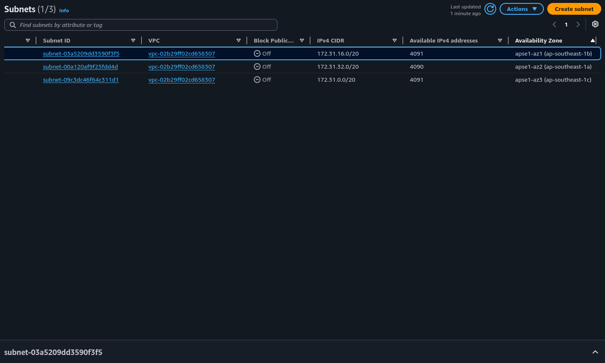
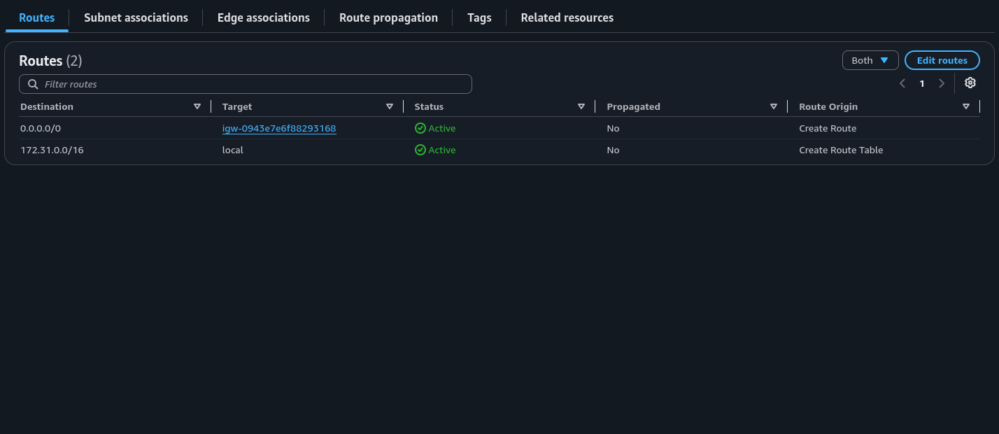
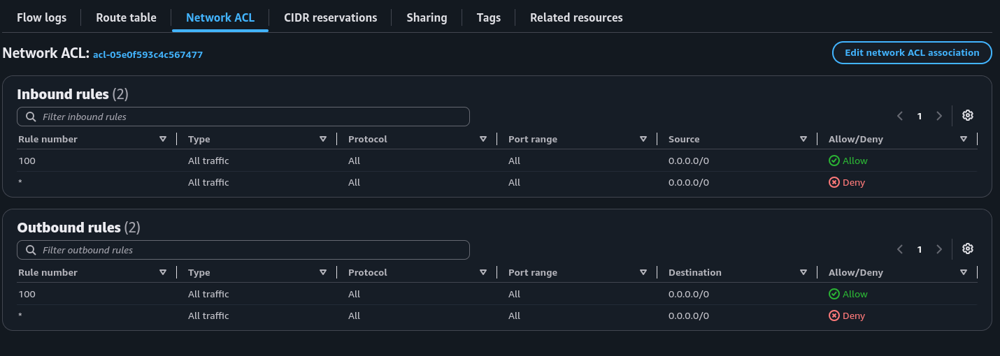
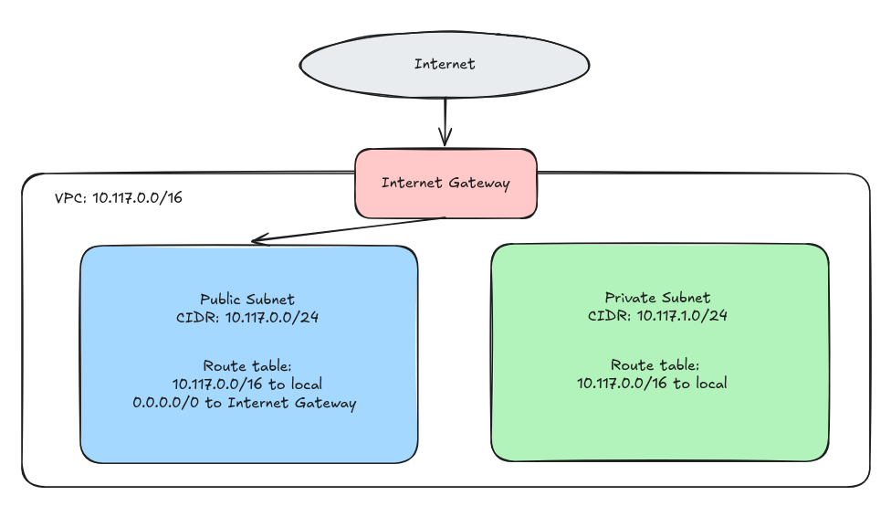

# Assignment 2 Submission
## About me

- GitHub username: CharlesTogle
- Section: IV-DCSAD
- IAM user name that I signed in with: dcsad-g04
- X: 117

---

## Part A. Explore

### A1. The VPC

Default VPC IPv4 CIDR:

172.31.0.0/16

Number of addresses in that CIDR:

65,536

### A2. The subnets

| Availability Zone | IPv4 CIDR      |
| ----------------- | -------------- |
| ap-southeast-1a   | 172.31.32.0/20 |
| ap-southeast-1b   | 172.31.16.0/20 |
| ap-southeast-1c   | 172.31.0.0/20  |

### A3. Available addresses

Available IPv4 addresses in each subnet:

| Availability Zone | Available IPv4 addresses |
| --- | ---: |
| `ap-southeast-1a` | 4,090 |
| `ap-southeast-1b` | 4,091 |
| `ap-southeast-1c` | 4,091 |

Why is the number lower than 4,096?

A `/20` has 4,096 addresses. AWS reserves 5 addresses in every subnet. An empty subnet has 4,096 − 5 = 4,091 available addresses.

What uses the missing address in the subnet with the lowest number?

The subnet 172.31.32.0/20 has one fewer available address because a network interface attached to an EC2 instance uses one IPv4 address in that subnet.
### A4. The route table

| Destination   | Target                |
| ------------- | --------------------- |
| 0.0.0.0/0     | igw-0943e7e6f88293168 |
| 172.31.0.0/16 | local                 |

### A5. Public or private

Are the default subnets public or private? Which route proves it?

Public. The route `0.0.0.0/0` sends traffic to the internet gateway.

### A6. The internet gateway

State of the internet gateway:

Attached

What happens to the default subnets if the gateway is detached?

The route `0.0.0.0/0` has no working target. The subnets lose their path to the internet. The instances can still reach each other through the local route.

### A7. NAT gateways

Number of NAT gateways:

0

Can a server in a new private subnet download updates? Why?

Not yet. A new private subnet has only the local route, so it has no route to the internet. The VPC has no NAT gateway today. To download updates, a NAT gateway would need to be created in a public subnet, and the private subnet’s route table would need a 0.0.0.0/0 route to that NAT gateway.

### A8. The network ACL

| Rule number | Source    | Allow or Deny |
| ----------- | --------- | ------------- |
| 100         | 0.0.0.0/0 | Allow         |
| *           | 0.0.0.0/0 | Deny          |

How is a network ACL different from a security group?

A network ACL protects a whole subnet. A security group protects one resource. A network ACL is stateless, so reply traffic needs its own outbound rule. A network ACL can also deny traffic. Network ACL rules are checked in numerical order: rule 100 allows all traffic from 0.0.0.0/0, and the * rule denies anything that did not match an earlier rule.

Screenshot 3. Save it as `screenshot-3-network-acl.png` in your folder. The image line below shows it.

### A9. The default security group

Inbound rule (type and source):

All traffic, from the `default` security group itself (`sg-...`).

Which resources can send traffic to an instance that uses it?

Only resources that also use the default security group can send traffic to the instance. The rule uses that security group as its source, and no other inbound rule allows other resources.

---

## Part B. Prepare

### B1. Plan two subnets

- Public subnet CIDR: 10.117.0.0/24
- Private subnet CIDR: 10.117.1.0/24

### B2. Route tables

Route table of the public subnet:

| Destination   | Target           |
| ------------- | ---------------- |
| 10.117.0.0/16 | local            |
| 0.0.0.0/0     | Internet Gateway |

Route table of the private subnet:

| Destination   | Target |
| ------------- | ------ |
| 10.117.0.0/16 | local  |

### B3. My VPC diagram

Tool used (Excalidraw, draw.io, Lucidchart, or paper):

Excalidraw

### B4. Predict a change

Can you still open the web page from your laptop? Why?

No. Removing the 0.0.0.0/0 route removes the path between the instance and the internet. Even with a public IPv4 address, the laptop cannot reach the instance without a route to the internet gateway.

Can the instance still reach another instance in the VPC? Why?

Yes. The instance can still reach another instance in the same VPC because the local route, 172.31.0.0/16 to local, remains in the route table. That route connects the VPC’s subnets even when the internet gateway route is removed.

### B5. Place a database

Which subnet gets the database? Why?

The database goes in the private subnet, 10.117.1.0/24. It cannot be reached directly from the internet because its route table has no internet gateway route. Other resources in the VPC can still reach it through the local route.

### B6. My question about VPCs

What is your question, and what made you think of it?

How does a NAT gateway allow a private server to receive replies from an internet request while blocking new inbound connections? I thought of this because I wanted to understand why NAT is not the same as port forwarding.
