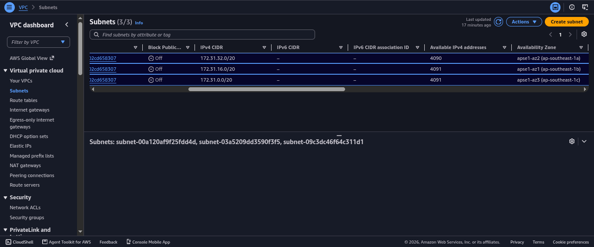
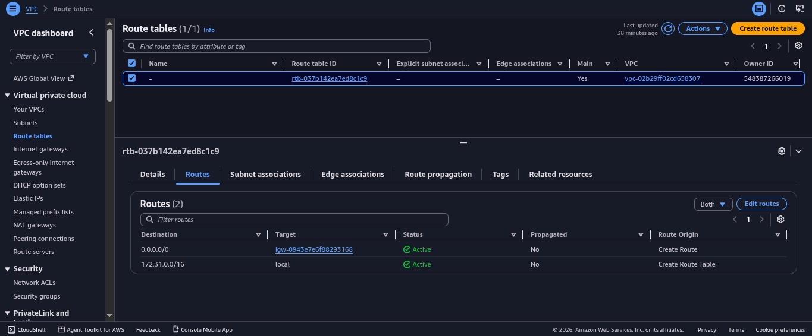
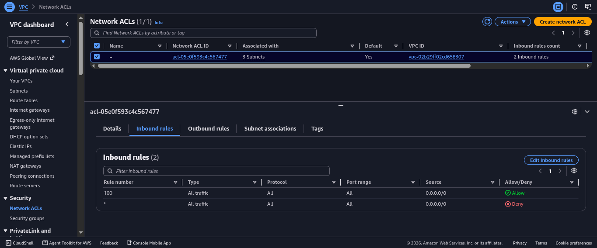
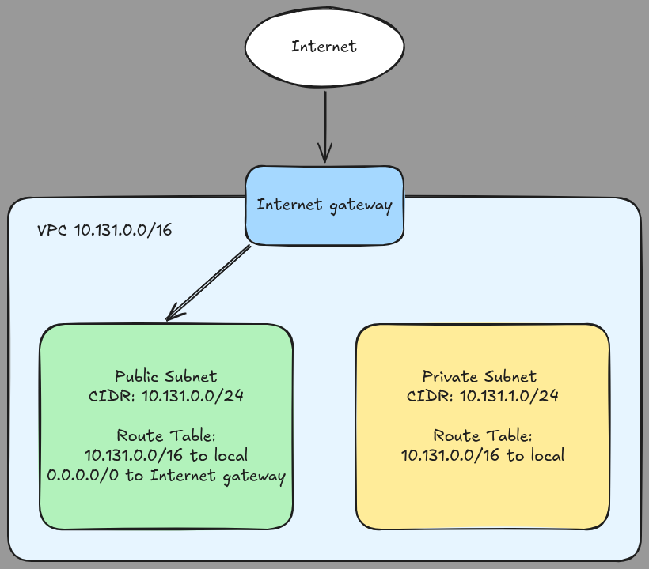

# Assignment 2 Submission

<!--
How to use this template:

1. Copy this file to submissions/assignment-2/<your-github-username>/submission.md
2. Replace every answer placeholder with your own answer. Delete the angle brackets too.
3. Save your four images in the same folder, with the exact file names below.
4. Do not write your full name or your student number in this file.
-->

## About me

- GitHub username: JoaquinLuisGuevarra96
- Section: IV-DCSAD
- IAM user name that I signed in with: dcsad-g04
- X: 131

---

## Part A. Explore

### A1. The VPC

Default VPC IPv4 CIDR:

Answer: 172.31.0.0/16

Number of addresses in that CIDR:

Answer: 65536 total addresses.

### A2. The subnets

| Availability Zone | IPv4 CIDR |
| --- | --- |
| apse1-az2 (ap-southeast-1a) | 172.31.32.0/20 |
| apse1-az1 (ap-southeast-1b) | 172.31.16.0/20 |
| apse1-az3 (ap-southeast-1c) | 172.31.0.0/20 |

Screenshot 1. Save it as `screenshot-1-subnets.png` in your folder. The image line below shows it.

### A3. Available addresses

Available IPv4 addresses in each subnet:

1. 172.31.32.0/20: 4090
2. 172.31.16.0/20: 4091
3. 172.31.0.0/20: 4091

Why is the number lower than 4,096?

Answer: A /20 subnet has 4096 total IPv4 addresses. AWS reserves 5 addresses in every subnet. That leaves 4,096 - 5 = 4,091 normally available. Additionally, the subnet showing 4090 has one additional address already in use by a resource.

What uses the missing address in the subnet with the lowest number?

Answer: The extra missing address is likely used by an Elastic Network Interface (ENI) for an EC2 instance, or another AWS resource in that subnet.

### A4. The route table

| Destination | Target |
| --- | --- |
| 0.0.0.0/0 | igw-0943e7e6f88293168 |
| 172.31.0.0/16 | local |

Screenshot 2. Save it as `screenshot-2-routes.png` in your folder. The image line below shows it.

### A5. Public or private

Are the default subnets public or private? Which route proves it?

Answer: The default subnets are public. The route that proves it is: `0.0.0.0/0 (igw-0943e7e6f88293168)`. A subnet is public when its associated route table has a route to an Internet gateway.

### A6. The internet gateway

State of the internet gateway:

Answer: Attached

What happens to the default subnets if the gateway is detached?

Answer: If the Internet gateway is detached, the default subnets lose Internet connectivity. The `0.0.0.0/0` route can no longer forward traffic to the Internet gateway, so instances in those subnets cannot reach the Internet, and inbound Internet traffic cannot reach them. The subnets become effectively private or have no Internet until the gateway is reattached.

### A7. NAT gateways

Number of NAT gateways:

Answer: 0 (No NAT gateways found)

Can a server in a new private subnet download updates? Why?

Answer: No. A private subnet does not have a route to an Internet gateway. To download updates, it would need a NAT gateway or NAT instance in a public subnet, plus a route in the private subnet’s route table pointing to that NAT device. Since there are 0 NAT gateways, the server cannot actually even reach the Internet for updates.

### A8. The network ACL

| Rule number | Source | Allow or Deny |
| --- | --- | --- |
| 100 | 0.0.0.0/0 | Allow |
| * | 0.0.0.0/0| Deny |

How is a network ACL different from a security group?

Answer: A `network ACL` usually has the following properties: it applies at the subnet level, it is stateless, it supports both Allow and Deny rules, and its rules are evaluated in order by rule number. A `security group` meanwhile has the following properties: it applies at the instance/ENI level, it is stateful, it only has Allow rules, and its return traffic is automatically allowed.

Screenshot 3. Save it as `screenshot-3-network-acl.png` in your folder. The image line below shows it.

### A9. The default security group

Inbound rule (type and source):

- Type: All traffic 
- Source: sg-0c5b6d4081cf0a534 / default

Which resources can send traffic to an instance that uses it?

Answer: Only resources that are associated with the same default security group can send inbound traffic to an instance using it. This is because the default security group has a self-referencing inbound rule, meaning it allows traffic from the security group itself. It does not allow the whole Internet by default.

---

## Part B. Prepare

### B1. Plan two subnets

- Public subnet CIDR: 10.131.0.0/24
- Private subnet CIDR: 10.131.1.0/24

### B2. Route tables

Route table of the public subnet:

| Destination | Target |
| --- | --- |
| 0.0.0.0/0 | internet gateway |
| 10.131.0.0/16 | local |

Route table of the private subnet:

| Destination | Target |
| --- | --- |
| 0.0.0.0/0 | NAT gateway |
| 10.131.0.0/16 | local |

### B3. My VPC diagram

Tool used (Excalidraw, draw.io, Lucidchart, or paper):

Answer: Excalidraw

Save your diagram as `vpc-diagram.png` in your folder. The image line below shows it.

### B4. Predict a change

Can you still open the web page from your laptop? Why?

Answer: No. Even if the instance still has a public IPv4 address, deleting the `0.0.0.0/0` route removes the path from the subnet to the Internet gateway. The instance’s response to the Internet cannot leave the VPC, so the connection cannot complete and the web page will not load.

Can the instance still reach another instance in the VPC? Why?

Answer: Yes. Traffic to another instance in the same VPC uses the `local` route, such as `172.31.0.0/16` in the default VPC. The deleted `0.0.0.0/0` route is only needed for traffic outside the VPC. As long as security groups and network ACLs allow it, the instance can still reach another instance in the same VPC.

### B5. Place a database

Which subnet gets the database? Why?

Answer: The database should go in the private subnet, `10.131.1.0/24`. A database should not be directly reachable from the Internet. The private subnet has no direct route to the Internet gateway, so it is not publicly accessible. Application servers can still reach it through the VPC’s local route, and if outbound updates are needed, the private route table can send traffic through a NAT gateway.

### B6. My question about VPCs

What is your question, and what made you think of it?

Question: A question I have is how does AWS choose between overlapping routes in a route table? For example: if my route table has `10.131.0.0/16 -> local` and `0.0.0.0/0 -> NAT gateway`, which route is used for traffic to `10.131.1.10`? I thought of this because B2 has both a VPC-wide local route and a default route, and I want to know how AWS prioritizes the more specific prefix.
