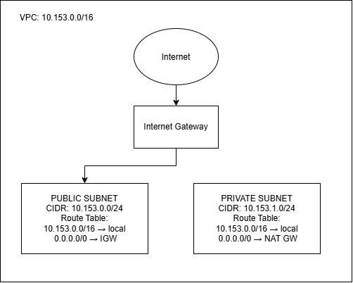

About me
GitHub username: MarcoLasaga
Section: IV-DCSAD
IAM user name that I signed in with: dcsad-g08 
X: 153
Part A. Explore
A1. The VPC
Default VPC IPv4 CIDR:

172.31.0.0/16

Number of addresses in that CIDR:

65,536

A2. The subnets
Availability Zone	        IPv4 CIDR
apse1-az2 (ap-southeast-1a)	172.31.32.0/20
apse1-az1 (ap-southeast-1b)	172.31.16.0/20
apse1-az3 (ap-southeast-1c)	172.31.0.0/20

Screenshot 1. In a real submission, the subnet list appears here. The top bar of the console is cropped out.

A3. Available addresses
Available IPv4 addresses in each subnet:

Availability Zone	        Available IPv4 address
apse1-az2 (ap-southeast-1a)	4090
apse1-az1 (ap-southeast-1b)	4091
apse1-az3 (ap-southeast-1c)	4091

Why is the number lower than 4,096?

Each /20 subnet has 4,096 IPv4 addresses, but AWS reserves five IPv4 addresses in every subnet. These reserved addresses are used by AWS for networking purposes, so the number of available addresses is lower than 4,096.

If one subnet shows one fewer available address than the others, the missing address is used by a resource or allocation in that subnet, such as an assigned private IPv4 address.

What uses the missing address in the subnet with the lowest number?

Three network interfaces hold one address each. Two belong to instances, and one belongs to the NAT gateway.

A4. The route table
Destination	   Target
0.0.0.0/0      igw-0943e7e6f88293168
172.31.0.0/16  local

Screenshot 2. In a real submission, the Routes tab appears here.

A5. Public or private
Are the default subnets public or private? Which route proves it?

The default subnets are public because the route table contains a default route with destination 0.0.0.0/0 that points to an Internet Gateway.

A6. The internet gateway
State of the internet gateway:

Attached

What happens to the default subnets if the gateway is detached?

If the Internet Gateway is detached from the VPC, the default subnets would no longer have a working path to the internet through that Internet Gateway. The subnets would still exist, but the internet-bound route would no longer provide internet connectivity.

A7. NAT gateways
Number of NAT gateways:

0

Can a server in a new private subnet download updates? Why?

If a private subnet is added to the VPC today and there is no NAT Gateway available for it, a server in the private subnet cannot download updates directly from the internet. A private subnet does not have a direct route to an Internet Gateway. It would need a NAT Gateway and an appropriate route to reach the internet for outbound connections.

A8. The network ACL
Rule number	 Source	         Allow or Deny
100	         0.0.0.0/0	     Allow
*	         0.0.0.0/0	     Deny
How is a network ACL different from a security group?

A network ACL controls traffic at the subnet level and is stateless, so inbound and outbound traffic are evaluated separately. A security group works at the instance/resource level and is stateful, so return traffic for an allowed connection is automatically allowed.

Screenshot 3. In a real submission, the Inbound rules tab appears here.

A9. The default security group
Inbound rule (type and source):

Type            Source
All traffic     sg-0c5b6d4081cf0a534...

Which resources can send traffic to an instance that uses it?

Resources that can send traffic to an instance using this security group are determined by the source specified in its inbound rule. For the default security group, the default inbound rule normally allows traffic from resources associated with the same security group.

Part B. Prepare
B1. Plan two subnets
My value of X is 153.
VPC CIDR: 10.153.0.0/16
Public subnet: 10.153.0.0/24
Private subnet: 10.153.1.0/24

B2. Route tables
Route table of the public subnet:

Destination	    Target
10.153.0.0/16	local
0.0.0.0/0	    internet gateway

Route table of the private subnet:

Destination	    Target
10.153.0.0/16	local
0.0.0.0/0       NAT Gateway

B3. My VPC diagram
Tool used (Excalidraw, draw.io, Lucidchart, or paper): draw.io

B3: sample VPC diagram for X = 153

In a real submission.md, this image line is . To see how the example diagram is built, open diagrams/a2-06-sample-plan.excalidraw in Excalidraw. Draw your own diagram with your own X.

B4. Predict a change
Can you still open the web page from your laptop? Why?

No. If the 0.0.0.0/0 route is deleted from the default route table, the instance no longer has a default route to the Internet Gateway. Therefore, traffic from my laptop on the internet would not have a route to reach the instance.

Can the instance still reach another instance in the VPC? Why?

Yes. The local route for the VPC remains in the route table. Traffic between resources using addresses within the VPC can continue using the local route even if the internet route is deleted.

B5. Place a database
Which subnet gets the database? Why?

I would put the database server in the private subnet.

A database normally does not need to be directly accessible from the public internet. Placing it in the private subnet provides an additional layer of protection because there is no direct route from the private subnet to the Internet Gateway. Application servers in the public subnet can communicate with the database through the VPC while the database remains private.

B6. My question about VPCs
What is your question, and what made you think of it?

Question: How does AWS decide which Availability Zone should contain a subnet when a subnet is created, and what happens if the Availability Zone becomes unavailable?

I thought of this because a VPC can have multiple subnets in different Availability Zones, and I wanted to understand how Availability Zones affect the availability and reliability of resources placed inside those subnets.