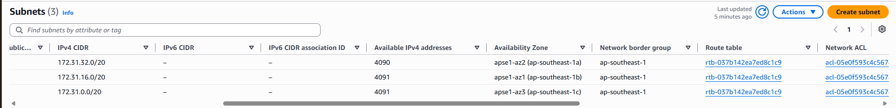
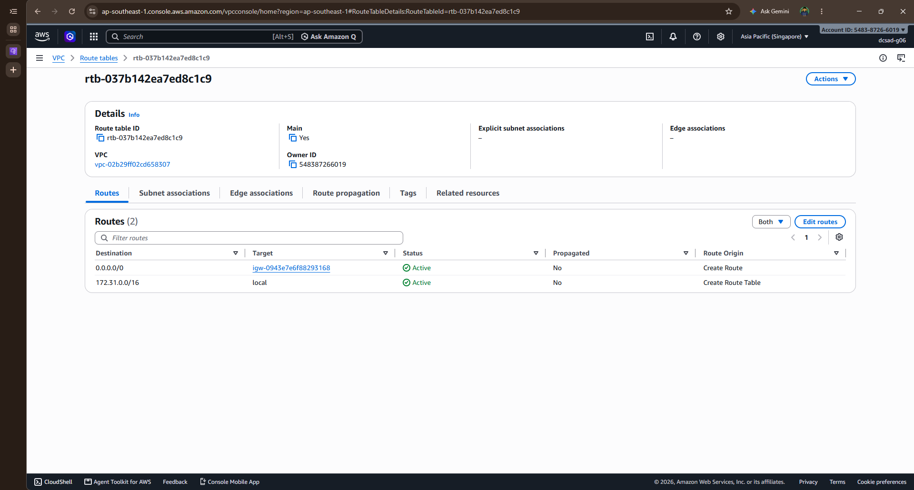
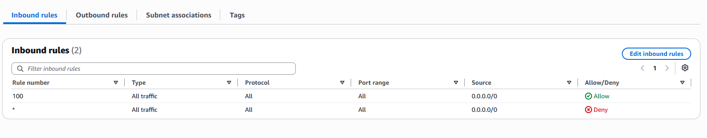
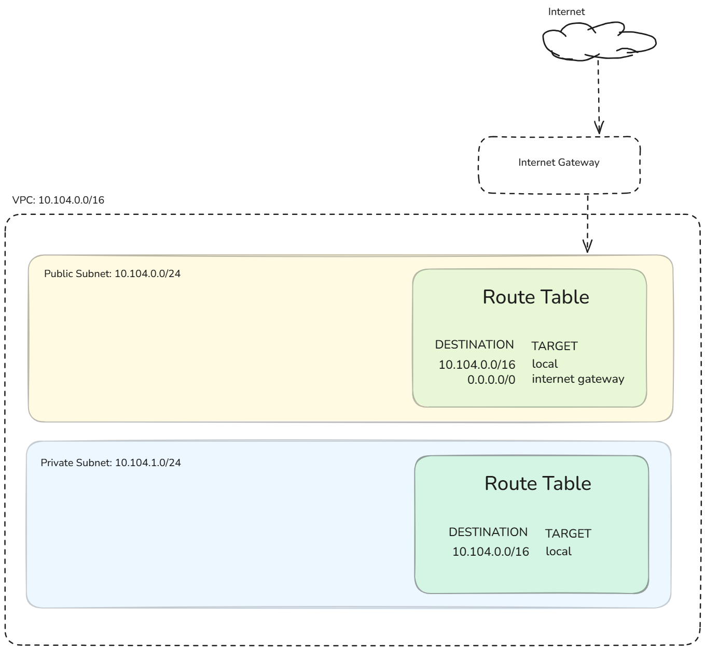

# Assignment 2 Submission

<!--
How to use this template:

1. Copy this file to submissions/assignment-2/<your-github-username>/submission.md
2. Replace every answer placeholder with your own answer. Delete the angle brackets too.
3. Save your four images in the same folder, with the exact file names below.
4. Do not write your full name or your student number in this file.
-->

## About me

- GitHub username: astennue
- Section: IV-DCSAD
- IAM user name that I signed in with: dcsad-g06
- X: 104

---

## Part A. Explore

### A1. The VPC

Default VPC IPv4 CIDR:

172.31.0.0/16

Number of addresses in that CIDR:

65,536

### A2. The subnets

| Availability Zone | IPv4 CIDR |
| --- | --- |
| ap-southeast-1a | 172.31.32.0/20 |
| ap-southeast-1b | 172.31.16.0/20 |
| ap-southeast-1c | 172.31.0.0/20 |

Screenshot 1. Save it as `screenshot-1-subnets.png` in your folder. The image line below shows it.

### A3. Available addresses

Available IPv4 addresses in each subnet:

ap-southeast-1a: 4090
ap-southeast-1b: 4091
ap-southeast-1c: 4091

Why is the number lower than 4,096?

AWS reserves 5 IP addresses in every subnet for its own networking purposes (network address, VPC router, DNS, future use, and broadcast).

What uses the missing address in the subnet with the lowest number?

A running resource or Network Interface (ENI) in ap-southeast-1a is using that extra IP address.

### A4. The route table

| Destination | Target |
| --- | --- |
| 0.0.0.0/0 | igw-0943e7e6f88293168 |
| 172.31.0.0/16 | local |

Screenshot 2. Save it as `screenshot-2-routes.png` in your folder. The image line below shows it.

### A5. Public or private

Are the default subnets public or private? Which route proves it?

The default subnets are public. The route with Destination `0.0.0.0/0` targeting the Internet Gateway `igw-0943e7e6f88293168` proves it, as it allows traffic to and from the internet.

### A6. The internet gateway

State of the internet gateway:

attached

What happens to the default subnets if the gateway is detached?

The default subnets lose direct connectivity to and from the internet, effectively converting them into private subnets.

### A7. NAT gateways

Number of NAT gateways:

0

Can a server in a new private subnet download updates? Why?

No. A private subnet requires a NAT gateway (or NAT instance) in a public subnet to translate outbound traffic to the internet, and since there are 0 NAT gateways, outbound internet access is unavailable.

### A8. The network ACL

| Rule number | Source | Allow or Deny |
| --- | --- | --- |
| 100 | 0.0.0.0/0 | Allow |
| * | 0.0.0.0/0 | Deny |

How is a network ACL different from a security group?

A Network ACL operates at the subnet level and is stateless (requiring explicit rules for both inbound and outbound traffic), whereas a Security Group operates at the instance/resource level and is stateful (automatically allowing return traffic).

Screenshot 3. Save it as `screenshot-3-network-acl.png` in your folder. The image line below shows it.

### A9. The default security group

Inbound rule (type and source):

Type: All traffic, Source: sg-08537... (the default security group itself)

Which resources can send traffic to an instance that uses it?

Only instances or resources that are explicitly assigned to the same default security group can send traffic to it.

---

## Part B. Prepare

### B1. Plan two subnets

- Public subnet CIDR: 10.104.0.0/24
- Private subnet CIDR: 10.104.1.0/24

### B2. Route tables

Route table of the public subnet:

| Destination | Target |
| --- | --- |
| 10.104.0.0/16 | local |
| 0.0.0.0/0 | internet gateway |

Route table of the private subnet:

| Destination | Target |
| --- | --- |
| 10.104.0.0/16 | local |

### B3. My VPC diagram

Tool used (Excalidraw, draw.io, Lucidchart, or paper):

Excalidraw

Save your diagram as `vpc-diagram.png` in your folder. The image line below shows it.

### B4. Predict a change

Can you still open the web page from your laptop? Why?

No. Removing the `0.0.0.0/0` route to the internet gateway breaks the path between the internet and the instance, so your laptop can no longer reach it over the public network.

Can the instance still reach another instance in the VPC? Why?

Yes. The local route (`172.31.0.0/16` -> local) is still active in the route table, allowing internal traffic between resources in the same VPC to work normally.

### B5. Place a database

Which subnet gets the database? Why?

The private subnet. Databases contain sensitive data and should not be directly accessible from the public internet; placing it in a private subnet prevents unauthorized internet traffic from reaching it while still allowing internal application servers to connect.

### B6. My question about VPCs

What is your question, and what made you think of it?

How does AWS handle IP address conflicts if two connected VPCs (via VPC Peering or Transit Gateway) use overlapping CIDR blocks? I thought of this while creating the subnets and wondering what happens when different private networks need to communicate.
