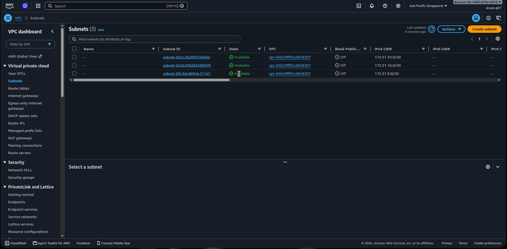
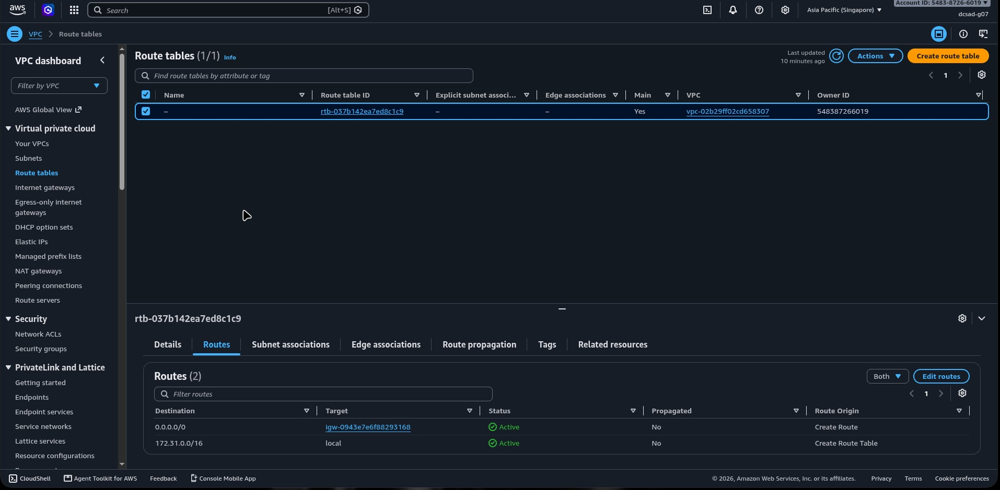
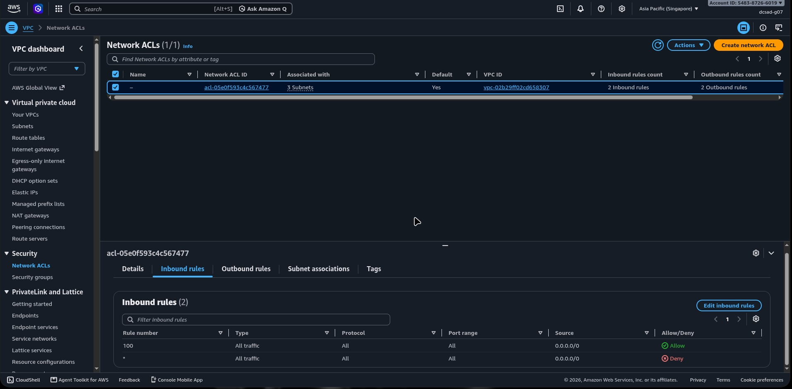
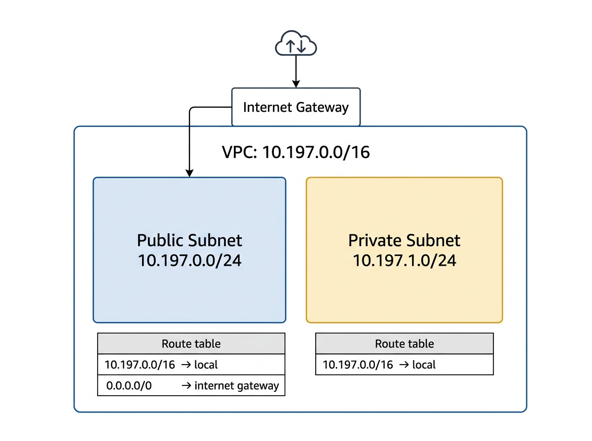

# Assignment 2 Submission

## About me

- GitHub username: ichannnj
- Section: IV-DCSAD
- IAM user name that I signed in with: `dcsad-g07`
- X: 197

---

## Part A. Explore

### A1. The VPC

Default VPC IPv4 CIDR:

`172.31.0.0/16`

Number of addresses in that CIDR:

65,536

### A2. The subnets

| Availability Zone | IPv4 CIDR |
| --- | --- |
| `ap-southeast-1a` | `172.31.32.0/20` |
| `ap-southeast-1b` | `172.31.16.0/20` |
| `ap-southeast-1c` | `172.31.0.0/20` |

Screenshot 1. Save it as `screenshot-1-subnets.png` in your folder. The image line below shows it.

### A3. Available addresses

Available IPv4 addresses in each subnet:

`ap-southeast-1a`: 4,090 — `ap-southeast-1b`: 4,091 — `ap-southeast-1c`: 4,091

Why is the number lower than 4,096?

AWS reserves 5 addresses in every subnet: the first four and the last one. So a `/20` subnet with 4,096 addresses has only 4,091 usable addresses when empty.

What uses the missing address in the subnet with the lowest number?

`ap-southeast-1a` shows 4,090 — one address fewer than the other two. A network interface (attached to a running EC2 instance or another AWS resource) is using that address.

### A4. The route table

| Destination | Target |
| --- | --- |
| `172.31.0.0/16` | `local` |
| `0.0.0.0/0` | `igw-0943e7e6f88293168` |

Screenshot 2. Save it as `screenshot-2-routes.png` in your folder. The image line below shows it.

### A5. Public or private

Are the default subnets public or private? Which route proves it?

The default subnets are public. The route `0.0.0.0/0 → igw-0943e7e6f88293168` proves it — it sends all internet-bound traffic to the internet gateway, which makes these subnets reachable from the internet.

### A6. The internet gateway

State of the internet gateway:

Attached

What happens to the default subnets if the gateway is detached?

The route `0.0.0.0/0` loses its working target. The default subnets lose their path to the internet — instances can no longer reach or be reached from the internet. They can still communicate with each other through the local route.

### A7. NAT gateways

Number of NAT gateways:

0

Can a server in a new private subnet download updates? Why?

No. There are no NAT gateways in this VPC. A server in a private subnet has no path to the internet, so it cannot download updates. A NAT gateway must first be created and its route (`0.0.0.0/0 → NAT gateway`) added to the private subnet's route table.

### A8. The network ACL

| Rule number | Source | Allow or Deny |
| --- | --- | --- |
| 100 | `0.0.0.0/0` | Allow |
| `*` | `0.0.0.0/0` | Deny |

How is a network ACL different from a security group?

A network ACL applies to an entire subnet, while a security group applies to a single resource such as an instance. A network ACL is stateless — reply traffic needs its own outbound rule — while a security group is stateful and automatically allows replies. A network ACL also supports both allow and deny rules, whereas a security group only has allow rules.

Screenshot 3. Save it as `screenshot-3-network-acl.png` in your folder. The image line below shows it.

### A9. The default security group

Inbound rule (type and source):

All traffic, from `sg-0c5b6d4081cf0a534` (the `default` security group itself).

Which resources can send traffic to an instance that uses it?

Only resources that also use the `default` security group. No other inbound rule exists, so all traffic from any other source is blocked.

---

## Part B. Prepare

### B1. Plan two subnets

- Public subnet CIDR: `10.197.0.0/24`
- Private subnet CIDR: `10.197.1.0/24`

### B2. Route tables

Route table of the public subnet:

| Destination | Target |
| --- | --- |
| `10.197.0.0/16` | `local` |
| `0.0.0.0/0` | internet gateway |

Route table of the private subnet:

| Destination | Target |
| --- | --- |
| `10.197.0.0/16` | `local` |

### B3. My VPC diagram

Tool used (Excalidraw, draw.io, Lucidchart, or paper):

Excalidraw

Save your diagram as `vpc-diagram.png` in your folder. The image line below shows it.

### B4. Predict a change

Can you still open the web page from your laptop? Why?

No. Without the route `0.0.0.0/0`, there is no path between my laptop on the internet and the instance. A public IP address alone is not enough — the route table must direct traffic to the internet gateway, and without that route, the traffic has nowhere to go.

Can the instance still reach another instance in the VPC? Why?

Yes. The local route for the VPC range `172.31.0.0/16` is still in the route table. That route connects every subnet in the VPC, so instances can still communicate with each other.

### B5. Place a database

Which subnet gets the database? Why?

The private subnet, `10.197.1.0/24`. Its route table has no route to an internet gateway, so nobody on the internet can directly reach the database. This reduces the attack surface and follows the principle that databases should not be publicly accessible.

### B6. My question about VPCs

What is your question, and what made you think of it?

If two EC2 instances are in different subnets of the same VPC, does traffic between them ever leave the AWS network or go through the internet gateway? I thought of it when I noticed that the local route in a route table covers the entire VPC CIDR — it made me wonder exactly what path the packets take, and whether a security group inbound rule is still needed even if the traffic is purely internal.
