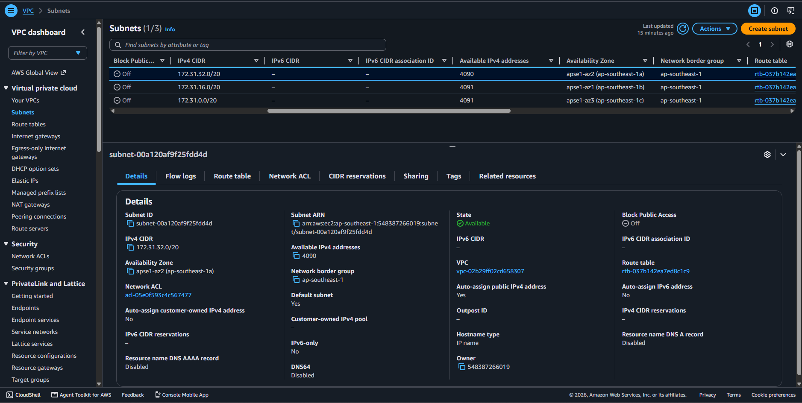
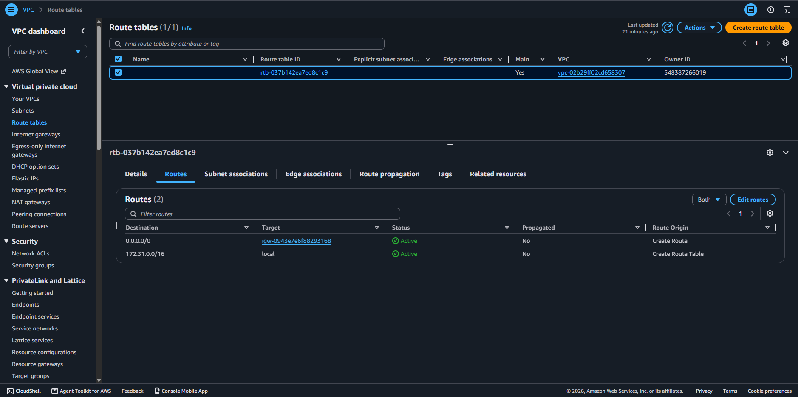
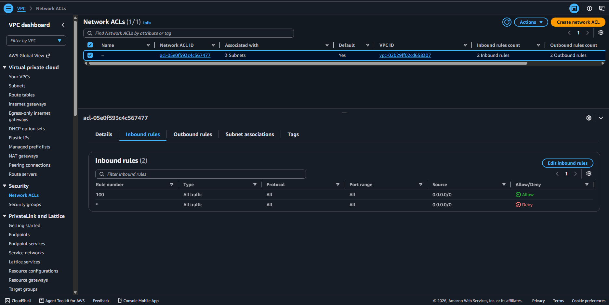
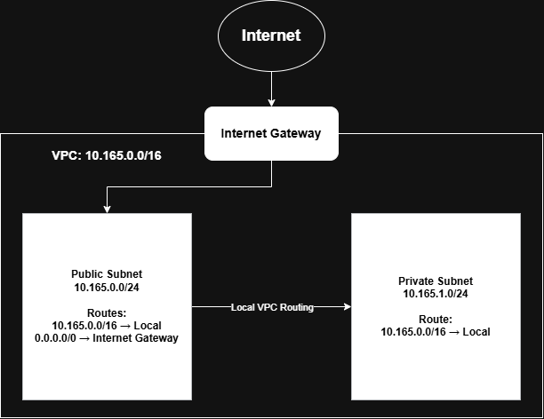

# Assignment 2 Submission

<!--
How to use this template:

1. Copy this file to submissions/assignment-2/<your-github-username>/submission.md
2. Replace every answer placeholder with your own answer. Delete the angle brackets too.
3. Save your four images in the same folder, with the exact file names below.
4. Do not write your full name or your student number in this file.
-->

## About me

- GitHub username: jayveeonuni
- Section: IV-DCSAD
- IAM user name that I signed in with: dcsad-g06
- X: 165

---

## Part A. Explore

### A1. The VPC

Default VPC IPv4 CIDR:

172.31.0.0/16

Number of addresses in that CIDR:

65,536

### A2. The subnets

| Availability Zone | IPv4 CIDR |
| --- | --- |
| apse1-az2 (ap-southeast-1a) | 172.31.32.0/20 |
| apse1-az1 (ap-southeast-1b) | 172.31.16.0/20 |
| apse1-az3 (ap-southeast-1c) | 172.31.0.0/20 |

Screenshot 1. 

### A3. Available addresses

Available IPv4 addresses in each subnet:

| Availability Zone | Available IPv4 addresses |
|---|---:|
| `ap-southeast-1a` | 4,090 |
| `ap-southeast-1b` | 4,091 |
| `ap-southeast-1c` | 4,091 |

Why is the number lower than 4,096?

A /20 subnet contains 4,096 addresses, but AWS reserves five addresses for network functions. This leaves 4,091 addresses before any are allocated to resources. Network interfaces using private addresses reduce the available count further.

What uses the missing address in the subnet with the lowest number?

The additional address is allocated to a network interface, such as an EC2 instance’s network interface. An instance can still hold its private IP address while stopped.

### A4. The route table

| Destination | Target |
| --- | --- |
| 0.0.0.0/0 | igw-... |
| 172.31.0.0/16 | local |

Screenshot 2. 

### A5. Public or private

Are the default subnets public or private? Which route proves it?

The default subnets are public because their route table contains the route 0.0.0.0/0 to an internet gateway.

### A6. The internet gateway

State of the internet gateway:

Attached

What happens to the default subnets if the gateway is detached?

If you detach the internet gateway, resources in the VPC cannot communicate with the internet. 

### A7. NAT gateways

Number of NAT gateways:

0

Can a server in a new private subnet download updates? Why?

A server in a new private subnet cannot download updates from the internet using this network’s IPv4 setup because it has no outbound internet path. It would need a suitable NAT gateway and a route sending internet traffic to that gateway.

### A8. The network ACL

| Rule number | Source | Allow or Deny |
| --- | --- | --- |
| 100 | 0.0.0.0/0 | Allow |
| * | 0.0.0.0/0 | Deny |

How is a network ACL different from a security group?

A network ACL controls traffic at subnet boundaries and supports both allow and deny rules, while a security group controls traffic for resources and has allow rules only. A network ACL is stateless, so reply traffic needs appropriate rules in the opposite direction; a security group tracks permitted connections and automatically permits their replies.

Screenshot 3. 

### A9. The default security group

Inbound rule (type and source):

Type: All traffic
  
Source: the default security group’s own ID(0.0.0.0/0)

Which resources can send traffic to an instance that uses it?

This inbound rule permits traffic from resources whose network interfaces are assigned to the same default security group. It does not permit incoming connections from every internet address or every resource in the VPC.

---

## Part B. Prepare

### B1. Plan two subnets

- Public subnet CIDR: 10.165.0.0/24
- Private subnet CIDR: 10.165.1.0/24

### B2. Route tables

Route table of the public subnet:

| Destination | Target |
| --- | --- |
| 10.165.0.0/16 | local |
| 0.0.0.0/0 | internet gateway |

Route table of the private subnet:

| Destination | Target |
| --- | --- |
| 10.165.0.0/16 | local |

### B3. My VPC diagram

Tool used (Excalidraw, draw.io, Lucidchart, or paper):

draw.io

### B4. Predict a change

Can you still open the web page from your laptop? Why?

No, assuming the deleted route was its only internet path. Removing 0.0.0.0/0 from the route table breaks communication with internet destinations. The instance’s public IPv4 address alone does not provide a working route.

Can the instance still reach another instance in the VPC? Why?

Yes, using the other instance’s private IP address, provided security groups and network ACLs permit the traffic. The local route for the VPC remains, so internal routing still works.

### B5. Place a database

Which subnet gets the database? Why?

I would place the database in the private subnet, 10.165.1.0/24, because its route table has no direct internet gateway route. The application can access it through private VPC routing, with security group rules allowing database connections only from the required application resources.

### B6. My question about VPCs

What is your question, and what made you think of it?

If a subnet belongs to one Availability Zone, how should an application and its database be placed across multiple zones so they can keep working when one zone fails? I thought of this because our design has only one public subnet and one private subnet, while the learning guide explains that Availability Zones have separate infrastructure.
