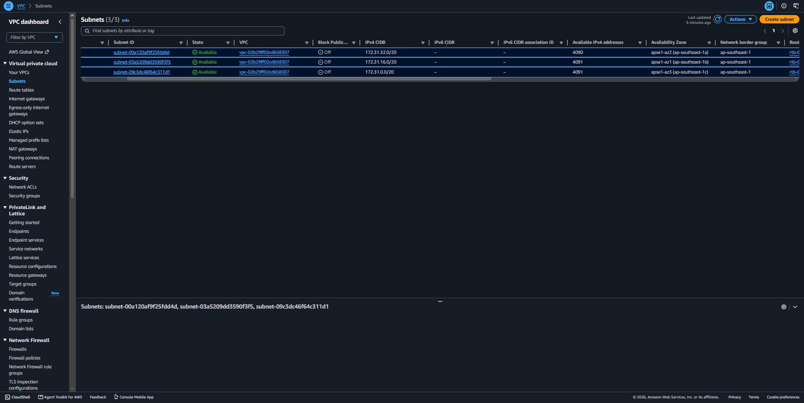
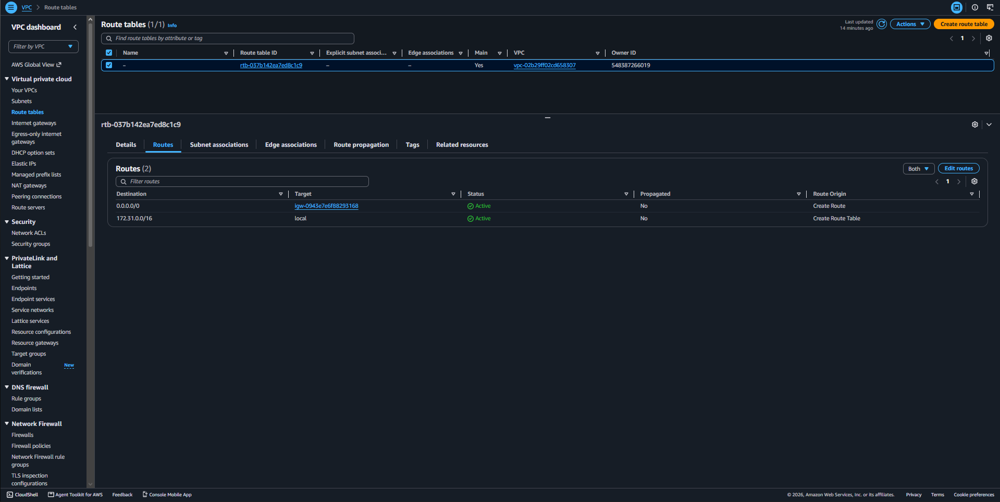
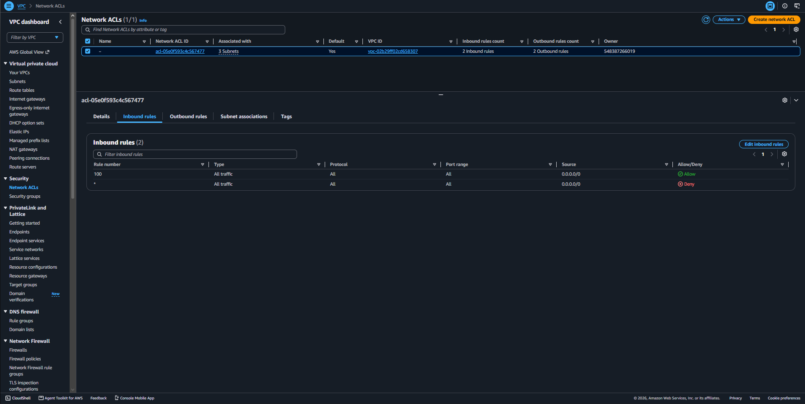
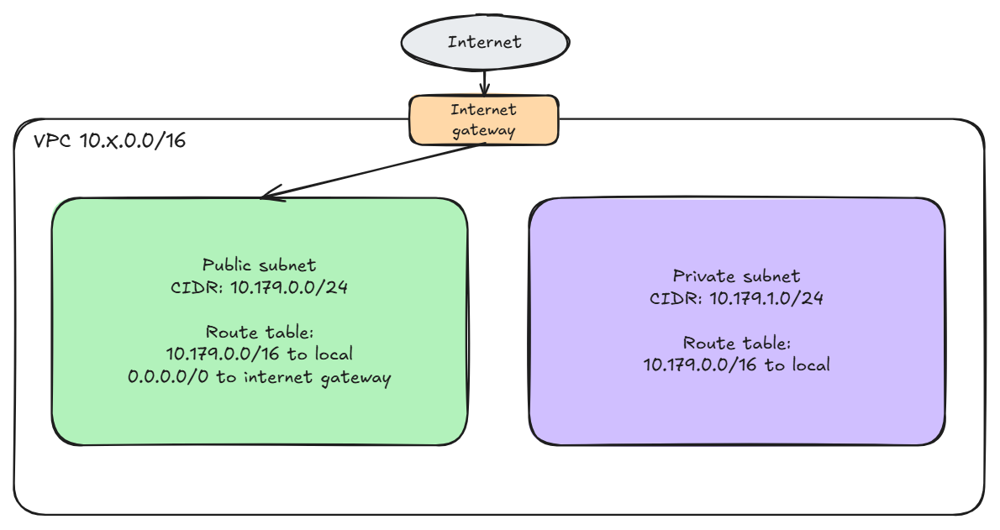

# Assignment 2 Submission

<!--
How to use this template:

1. Copy this file to submissions/assignment-2/<your-github-username>/submission.md
2. Replace every answer placeholder with your own answer. Delete the angle brackets too.
3. Save your four images in the same folder, with the exact file names below.
4. Do not write your full name or your student number in this file.
-->

## About me

- GitHub username: jjcabalo
- Section: IV-DCSAD
- IAM user name that I signed in with: dcsad-g05
- X: 179

---

## Part A. Explore

### A1. The VPC

Default VPC IPv4 CIDR:

172.31.0.0/16

Number of addresses in that CIDR:

65,536

### A2. The subnets

| Availability Zone | IPv4 CIDR |
| --- | --- |
| apse1-az2 (ap-southeast-1a)  |172.31.32.0/20  |
| apse1-az1 (ap-southeast-1b)|172.31.16.0/20|
| apse1-az3 (ap-southeast-1c)  |172.31.0.0/20  |

Screenshot 1. Save it as `screenshot-1-subnets.png` in your folder. The image line below shows it.

### A3. Available addresses

Available IPv4 addresses in each subnet:

ap-southeast-1a: 4,090  
ap-southeast-1b: 4,091  
ap-southeast-1c: 4,091  

Why is the number lower than 4,096?

A /20 subnet has 4,096 total IP addresses but AWS keeps 5 of them reserved for its networking functions. Because of this only 4,091 addresses are available for use.

What uses the missing address in the subnet with the lowest number?

The extra IP is currently assigned to a network interface which is most likely being used by an active EC2 instance.

### A4. The route table

| Destination | Target |
| --- | --- |
| 0.0.0.0/0 | igw |
| 172.31.0.0/16 | local |

Screenshot 2. Save it as `screenshot-2-routes.png` in your folder. The image line below shows it.

### A5. Public or private

Are the default subnets public or private? Which route proves it?

The default subnets are public since their route table includes 0.0.0.0/0 that directs traffic through the Internet Gateway.

### A6. The internet gateway

State of the internet gateway:

Attached

What happens to the default subnets if the gateway is detached?

The subnets would no longer be able to access the internet because their connection to the Internet Gateway would be removed.

### A7. NAT gateways

Number of NAT gateways:

0

Can a server in a new private subnet download updates? Why?

No. Since there is no NAT Gateway, the private subnet has no way to send internet-bound traffic. As a result... a server inside it would not be able to connect to update servers.

### A8. The network ACL

| Rule number | Source | Allow or Deny |
| --- | --- | --- |
| 100 | 0.0.0.0/0 | Allow |
| * | 0.0.0.0/0 | Deny |

How is a network ACL different from a security group?

A security group controls traffic for a specific resource, such as an EC2 instance, and only allows allow rules. A network ACL works at the subnet level and can have both allow and deny rules.

Screenshot 3. Save it as `screenshot-3-network-acl.png` in your folder. The image line below shows it.

### A9. The default security group

Inbound rule (type and source):

Type: All traffic; Source: sg-0c5b6d4081cf0a534

Which resources can send traffic to an instance that uses it?

Only resources that are associated with the sg-0c5b6d4081cf0a534 security group can send traffic to the instance.

---

## Part B. Prepare

### B1. Plan two subnets

- Public subnet CIDR: 10.179.0.0/24
- Private subnet CIDR: 10.179.1.0/24

### B2. Route tables

Route table of the public subnet:

| Destination | Target |
| --- | --- |
| 10.179.0.0/16 | local |
| 0.0.0.0/0 | internet gateway |

Route table of the private subnet:

| Destination | Target |
| --- | --- |
| 10.179.0.0/16 | local |

### B3. My VPC diagram

Tool used (Excalidraw, draw.io, Lucidchart, or paper):

Excalidraw

Save your diagram as `vpc-diagram.png` in your folder. The image line below shows it.

### B4. Predict a change

Can you still open the web page from your laptop? Why?

No, I can't open the web page anymore. Removing the 0.0.0.0/0 route removes the instance's path to the Internet Gateway. Even if the instance still has a public IP address, it cannot properly communicate with my laptop through the internet.

Can the instance still reach another instance in the VPC? Why?

Yes, it can. The 10.179.0.0/16 local route is still available, so traffic between resources inside the same VPC can stay within the VPC without going through the Internet Gateway.

### B5. Place a database

Which subnet gets the database? Why?
I would put the database in the private subnet, 10.179.1.0/24. A database usually does not need to be directly accessible from the internet. Keeping it private allows applications in the VPC to access it while reducing direct exposure to outside traffic.

### B6. My question about VPCs

What is your question, and what made you think of it?

I am curious if two different VPCs can communicate with each other even if they use different CIDR ranges? Because We learned that resources inside the same VPC can communicate using the local route. This made me wonder how resources in separate VPCs communicate when they are not part of the same local network.
