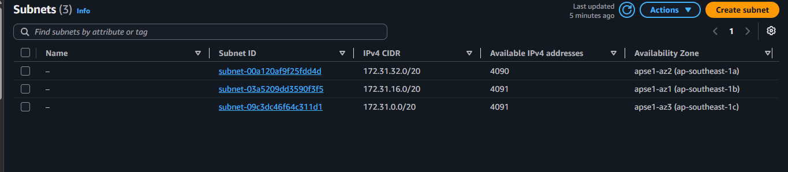
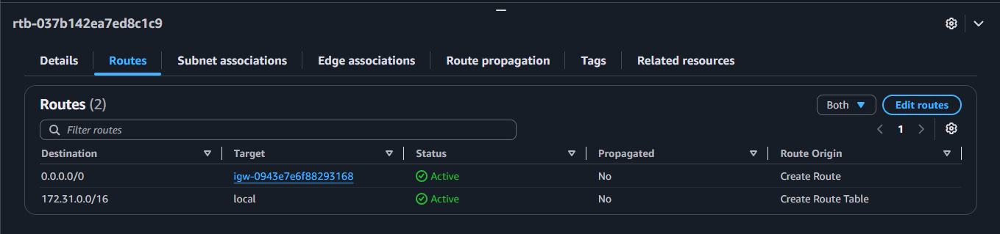
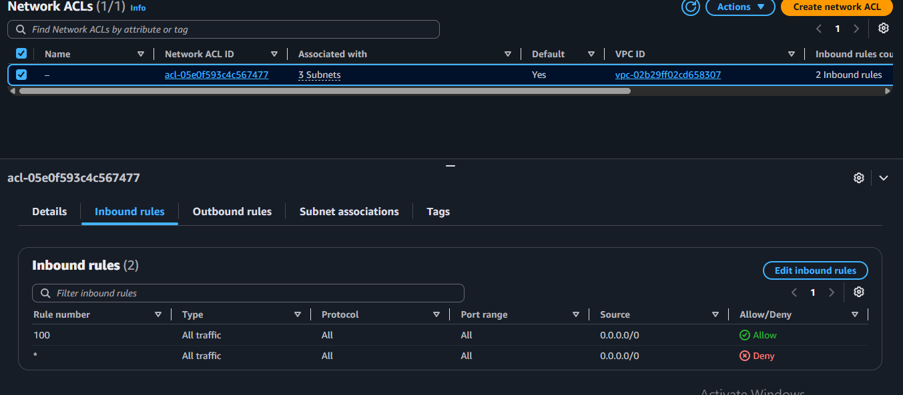
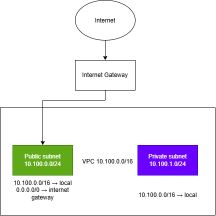

# Assignment 2 Submission

<!--
How to use this template:

1. Copy this file to submissions/assignment-2/<your-github-username>/submission.md
2. Replace every answer placeholder with your own answer. Delete the angle brackets too.
3. Save your four images in the same folder, with the exact file names below.
4. Do not write your full name or your student number in this file.
-->

## About me

- GitHub username: mmanzanilloa12241800-sudo
- Section: IV-DCSAD
- IAM user name that I signed in with: dcsad-g02
- X: 100

---

## Part A. Explore

### A1. The VPC

Default VPC IPv4 CIDR:

172.31.0.0/16

Number of addresses in that CIDR:

65,536

### A2. The subnets

| Availability Zone | IPv4 CIDR |
| --- | --- |
| ap-southeast-1a | 172.31.32.0/20 |
| ap-southeast-1b | 172.31.16.0/20 |
| ap-southeast-1c | 172.31.0.0/20 |

Screenshot 1. Save it as `screenshot-1-subnets.png` in your folder. The image line below shows it.

### A3. Available addresses

Available IPv4 addresses in each subnet:

| Availability Zone | Available IPv4 addresses |
| --- | --- |
| ap-southeast-1a | 4090 |
| ap-southeast-1b | 4091 |
| ap-southeast-1c | 4091 |

Why is the number lower than 4,096?

AWS reserves 5 addresses in every subnet: the first four and the last one. Instances cannot use them. So 4,096 - 5 = 4,091 usable addresses.

What uses the missing address in the subnet with the lowest number?

The ap-southeast-1a subnet shows 4090, one lower than the others. One more address is used by a network interface in that subnet, for example the instance from Lab 2.

### A4. The route table

| Destination | Target |
| --- | --- |
| 172.31.0.0/16 | local |
| 0.0.0.0/0 | igw- |

Screenshot 2. Save it as `screenshot-2-routes.png` in your folder. The image line below shows it.

### A5. Public or private

Are the default subnets public or private? Which route proves it?

The default subnets are public. The route 0.0.0.0/0 with target igw- sends internet traffic to the internet gateway, so the subnets can reach the internet and the internet can reach them.

### A6. The internet gateway

State of the internet gateway:

Attached

What happens to the default subnets if the gateway is detached?

The route 0.0.0.0/0 to the internet gateway would no longer work, so the default subnets would lose their path to the internet. The internet could not reach instances in them, and the instances could not reach the internet. Traffic inside the VPC would still work through the local route.

### A7. NAT gateways

Number of NAT gateways:

0

Can a server in a new private subnet download updates? Why?

No. A private subnet has no route to the internet gateway, and there is no NAT gateway to send its internet traffic through. Without a route 0.0.0.0/0 to a NAT gateway (placed in a public subnet), the server has no path to the internet.

### A8. The network ACL

| Rule number | Source | Allow or Deny |
| --- | --- | --- |
| 100 | 0.0.0.0/0 | Allow |
| * | 0.0.0.0/0 | Deny |

How is a network ACL different from a security group?

A network ACL works on a whole subnet, is stateless, and has both allow and deny rules that AWS checks by number. A security group works on one resource, is stateful, and has allow rules only.

Screenshot 3. Save it as `screenshot-3-network-acl.png` in your folder. The image line below shows it.

### A9. The default security group

Inbound rule (type and source):

Type: All traffic. Source: sg-0c5b6d4081cf0a534

Which resources can send traffic to an instance that uses it?

Only resources that are members of the same default security group can send traffic to it. Traffic from the internet or from resources in other security groups is blocked.

---

## Part B. Prepare

### B1. Plan two subnets

- Public subnet CIDR: 10.100.0.0/24
- Private subnet CIDR: 10.100.1.0/24

### B2. Route tables

Route table of the public subnet:

| Destination | Target |
| --- | --- |
| 10.100.0.0/16 | local |
| 0.0.0.0/0 | internet gateway |

Route table of the private subnet:

| Destination | Target |
| --- | --- |
| 10.100.0.0/16 | local |

### B3. My VPC diagram

Tool used (Excalidraw, draw.io, Lucidchart, or paper):

draw.io

Save your diagram as `vpc-diagram.png` in your folder. The image line below shows it.

### B4. Predict a change

Can you still open the web page from your laptop? Why?

No. The route 0.0.0.0/0 to the internet gateway is gone, so traffic from my laptop has no path to the instance. The subnet becomes private.

Can the instance still reach another instance in the VPC? Why?

Yes. The local route 10.100.0.0/16 (the VPC range) is still in the route table, and it connects all subnets inside the VPC. Deleting the internet route does not remove it.

### B5. Place a database

Which subnet gets the database? Why?

The private subnet (10.100.1.0/24). It has no route to the internet gateway, so the internet cannot reach the database. Only resources inside the VPC can connect to it.

### B6. My question about VPCs

What is your question, and what made you think of it?

If a NAT gateway is in a public subnet and that subnet loses its 0.0.0.0/0 route to the internet gateway, can the private subnet still download updates?
