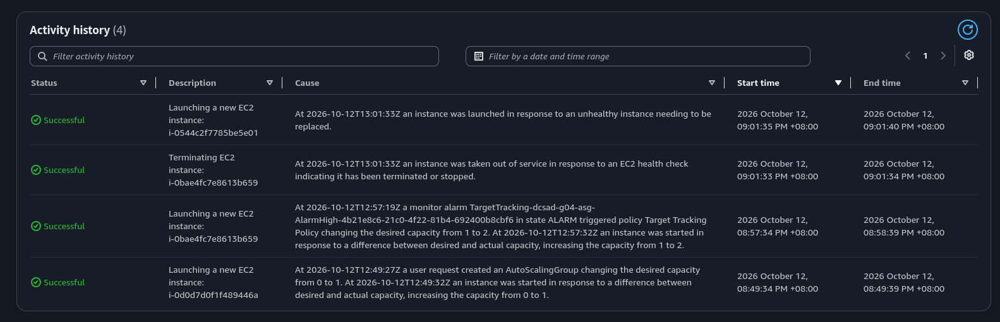
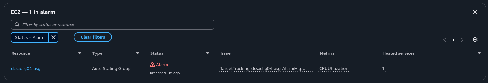

# Lab 2 Submission

## Instance Tracking
**First Instance**
- Instance ID: i-0d0d7d0f1f489446a
- Availability Zone: ap-southeast-1a

**Second Instance**
- Instance ID: i-0bae4fc7e8613b659
- Availability Zone: ap-southeast-1b

## Proof (Screenshots)
1. **Activity History:** Add a screenshot showing the Auto Scaling group's Activity history when the second instance launched.
   

2. **CloudWatch Alarm:** Add a screenshot of the target tracking alarm in the "In alarm" state.

## Questions
1. Why did the group stop at 2 instances?
   The group stopped at two instances because its maximum capacity was configured as 2. Even when CPU utilization remained above the target, Auto Scaling could not launch a third instance.
2. Why did terminating an instance by hand not remove the cost?
   Terminating an instance manually did not immediately remove the cost because the Auto Scaling group must maintain its desired capacity. When one of the two instances was terminated, the group automatically launched a replacement instance to return to the desired number of instances.
3. Why is the target value set to your assigned value (e.g., 30-85 percent) instead of 99 percent?
   The target value is set below 99% to leave CPU headroom for traffic spikes and normal system processes. A 99% target would keep instances nearly fully utilized, causing slower responses and potentially triggering CPU throttling or performance problems before Auto Scaling could react.
4. What did the automatic cutoff protect us from?
   The automatic cutoff protected us from unexpected or prolonged AWS costs. It ensured the Auto Scaling group and its EC2 instances were shut down after the lab instead of continuing to run if a team forgot to clean up.
5. What changes when a load balancer sits in front of the group?
   With a load balancer in front of the group, users send requests to one endpoint instead of directly to a specific instance. The load balancer distributes requests across healthy instances, prevents one server from receiving all traffic, and can stop routing requests to unhealthy instances.