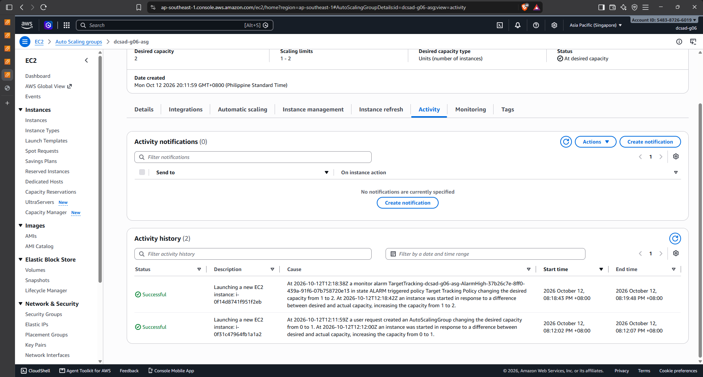
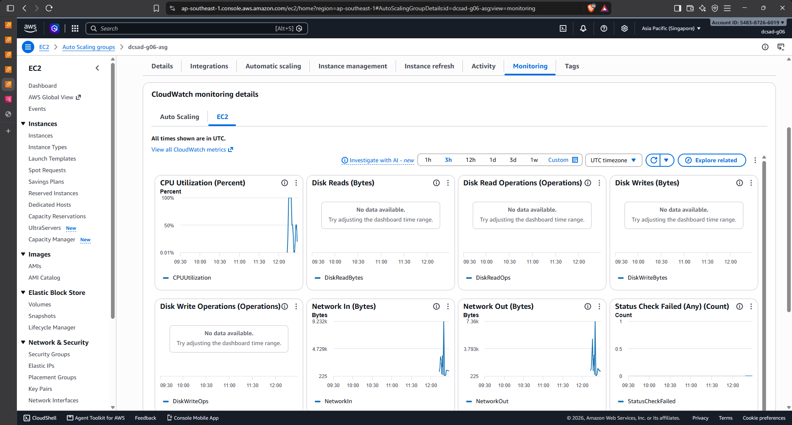

# Lab 2 Submission

## Instance Tracking
**First Instance**
- Instance ID: 0f14d8741f951f2eb
- Availability Zone: ap-southeast-1b

**Second Instance**
- Instance ID: 0f31c47964fb1a1a2
- Availability Zone: ap-southeast-1a

## Proof (Screenshots)
1. **Activity History:** Add a screenshot showing the Auto Scaling group's Activity history when the second instance launched.
   
   

2. **CloudWatch Alarm:** Add a screenshot of the target tracking alarm in the "In alarm" state.

   

## Questions
1. Why did the group stop at 2 instances?
   We set the maximum capacity to 2, so the Auto Scaling group could not launch more than two instances.
2. Why did terminating an instance by hand not remove the cost?
   The Auto Scaling group launched a replacement to maintain its desired capacity. The replacement instance continued generating charges.
3. Why is the target value set to your assigned value (e.g., 30-85 percent) instead of 99 percent?
   Our Group 6 target was 55%. This gives AWS time to add an instance before the existing server becomes overloaded. At 99%, there would be very little spare CPU capacity.
4. What did the automatic cutoff protect us from?
   It protected us from unexpected AWS charges if we forgot to clean up the running resources.
5. What changes when a load balancer sits in front of the group?
   Users access one address instead of each instance’s public IP. The load balancer distributes requests across healthy instances, including new instances added by Auto Scaling.
